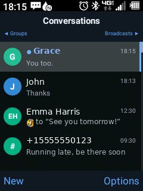

This App is designed to replace the stock messaging App on the Kyocera E4810 flip phone. (E4811 and E4610 may work but are not fully tested.)

Key features:

•	Speech-to-text provided using a Groq API key. Simply press the dictate button and say what you want it to type!

•	MMS support. Send and receive pictures, video, voice messages, contact cards and other files. Videos are compressed automatically to fit your carrier's picture-message size limit.

•	Group messaging support. Groups show up in a separate list.

•	Broadcast lists: text the same announcement to many people, each getting their own private text. Lists can be imported from a CSV file (one phone number per row, with an optional name column). Copy the file to the phone (for example to Download), then use Broadcast Lists > + New List from CSV.

•	Reactions: when an iPhone or Google Messages user reacts to a message ("Liked …", or a single 👍 sent right after it), the reaction shows under that message instead of as a separate text. To react, hold OK on a message, or use options/React (also while viewing a picture). Choosing the same emoji again takes it back. options/settings/advanced/Show Reactions turns it off.

•	Schedule Send: send a message on a day and time up to a week ahead (options/Schedule Send while writing).

•	Search a conversation: highlight a message, then press the left soft key (Search).

•	Contact Options (options/Contact Options on the conversation list): Add to Contacts, a Special Notification Sound for just that person, a Conversation Background, or Call (or press SEND).

•	Conversation Backgrounds: each conversation gets a picture behind it, picked from 44 built in, or your own picture from the gallery (Contact Options/Conversation Background). Turn them all off in options/settings/Theme.

•	Shortcut keys: the camera key takes a picture while writing, hold the mic button to dictate, and double-tap the mic button to record an audio message.

•	No signal? Messages wait ("Waiting for signal") and send by themselves when the phone has service again.

•	Notification sounds (options/settings/Notification Settings): pick from the phone's own sounds, 75 sounds built into TurboText (the Android Open Source Project's notification sounds, Apache License 2.0, see app/src/main/assets/sounds/NOTICE.txt), or your own files in Internal storage/notifications (.mp3, .ogg and .wav).

•	New Message lets you pick from the phone's contacts or type a number. If you already have a conversation with that person, it opens there.

•	Translation to English of incoming texts from most languages.

•	Archive Options (options/settings/Archive Options): saves every conversation, with pictures, to Documents/Archived conversations, readable on a PC ("Open me.html"), and imports an archive back onto a phone.

•	Outer-screen alerts like MatChat's: who it's from and the message, scrolling across the outer screen until you read it.

•	Optional daily texting report (options/settings/Report), protected by a PIN: once a day it texts a number you choose how many texts were sent to and received from each contact.

Screenshots:

 

The conversation list, and a conversation with a 👍 reaction and a Conversation Background.

Installation instructions:

1.	Install the TurboText app on the phone:
	a. You can install through Android Studio, or copy the .APK to the phone, then open it in the phone.
	b. When the App opens, go to: options/settings/advanced/ , set the default texting app to TurboText, and turn on “Background Helper” (it keeps TurboText running in the background without a notification; while it's off, TurboText shows a small “running” notification instead).
	c. Optional: you can set the “Trusted Provisioning Number” (options/settings/advanced/) if you want to be able to set the API key remotely. (See below for more details) This app is using Groq’s API Whisper Speech-to-text service. You will need a Groq API key to make it work.

There are two methods for entering the API key into the app.

1.	Copy and paste the key into the text file found in: Internal storage/Turbo key/
2.	You can set the key remotely by sending it from a Phone number that matches what you enter in step 1.c Above. The API key needs to be encoded using Base64 format (base64encode.org) then prefixed like follows: TURBOVOICE_SETUP:put your encoded api key here. Send this encoded and prefixed text to the phone that you are setting up, TurboText will read it and the Speech-to-text and translation should start working. (You should not see the text come into the phone. The app hides it and does not let you see it.)

Other settings in options/settings/advanced/:

•	Picture Delivery Reports: ask for a "Delivered" report on picture messages (off by default; many iPhones never send one back).

•	Messages Shown: how many of a conversation's newest messages it shows (100, 200, 500 or All). Fewer keeps long conversations quick; "Load More" at the top shows older ones.

•	Save Bug Report: saves a report to the Download folder, for when something goes wrong.

Updates:

TurboText checks this repo's GitHub Releases about once a week when you open the conversation list, and asks before installing a newer version (Wi-Fi is preferred for the download). You can also check any time from options/settings/advanced/Check for Updates. The first time, Android asks you to allow TurboText to install apps; allow it and the install carries on.

Publishing a release (for the maintainer):

1.	One time: create a release signing key and a keystore.properties file (see keystore.properties.example). Back up the key and its passwords. Android only installs an update signed with the same key as the installed app, so a lost key means every phone has to uninstall and reinstall. For the same reason, a phone running a debug build or an APK signed with a different key has to uninstall it once and install a signed release before in-app updates work.
2.	In app/build.gradle, raise versionCode by 1 and set versionName (e.g. "1.0.4"), then commit.
3.	Build the signed APK: ./gradlew :app:assembleRelease (output: app/build/outputs/apk/release/app-release.apk).
4.	On GitHub, go to Releases, Draft a new release, create the tag v. plus the versionName (e.g. v.1.0.4; v1.0.4 works too), attach app-release.apk, and click Publish release. Don't mark it as a draft or pre-release, because the app skips those. The repo has to stay public, since the app reads releases without logging in.

Disclaimer: I am not a programmer, I just like to make things work, and AI helps make things work. 😉
